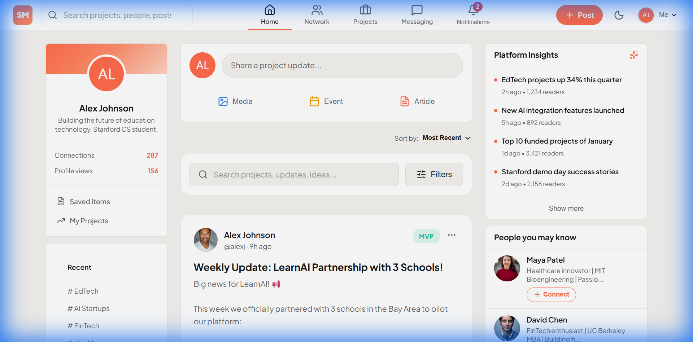

# SKUL MOGULZ

> **The Premier Platform for Student Innovation & Investment**

SKUL MOGULZ is a cutting-edge platform that connects young professionals and students with world-class investors. It provides an arena for showcasing projects, tracking progress, and securing funding.



---

## 🚀 Quick Start

### Prerequisites

- **Node.js** v18 or higher
- **npm** v9 or higher
- **Git**

### Installation

```bash
# Clone the repository
git clone https://github.com/Gideon-Dadey/SKUL-MOGULZ-PERSONAL-.git
cd SKUL-MOGULZ-PERSONAL-

# Install root dependencies
npm install

# Install client dependencies
cd client
npm install

# Start the development server
npm run dev
```

The application will be available at `http://localhost:5173`

---

## 📁 Project Structure

```
SKUL MOGULZ/
├── client/                      # Frontend React application
│   ├── src/
│   │   ├── assets/              # Static assets (images, icons)
│   │   ├── components/          # Reusable UI components
│   │   │   ├── PostCard/        # Post card component
│   │   │   └── SearchFilter/    # Search and filter component
│   │   ├── context/             # React Context providers
│   │   │   ├── AuthContext.tsx  # Authentication state
│   │   │   └── ThemeContext.tsx # Theme management
│   │   ├── data/                # Mock data for development
│   │   │   └── mockData.ts      # Sample users, posts, notifications
│   │   ├── hooks/               # Custom React hooks
│   │   ├── pages/               # Page components
│   │   │   ├── LandingPage.tsx  # Homepage/landing
│   │   │   ├── FeedPage/        # Main feed
│   │   │   ├── CreatePostPage/  # Create new post
│   │   │   ├── PostDetailPage/  # Post detail view
│   │   │   └── ProfilePage/     # User profile
│   │   ├── services/            # API service functions
│   │   ├── styles/              # Global CSS styles
│   │   │   └── index.css        # Main stylesheet
│   │   ├── types/               # TypeScript type definitions
│   │   │   ├── index.ts         # Core types
│   │   │   └── images.d.ts      # Image module declarations
│   │   ├── utils/               # Utility functions
│   │   ├── App.tsx              # Main application component
│   │   └── main.tsx             # Application entry point
│   ├── index.html               # HTML template
│   ├── package.json             # Client dependencies
│   ├── tsconfig.json            # TypeScript configuration
│   └── vite.config.ts           # Vite configuration
├── server/                      # Backend Node.js application (future)
├── docs/                        # Documentation
├── implementation_plan.md       # MVP implementation plan
├── package.json                 # Root package.json
└── README.md                    # This file
```

---

## ✨ Features

### MVP Features (Current)

| Feature | Description | Status |
|---------|-------------|--------|
| **User Registration** | Email-based signup with role selection (Student/Investor) | ✅ |
| **User Authentication** | Login/logout with localStorage persistence | ✅ |
| **Create Posts** | Publish project updates with category, stage, and funding info | ✅ |
| **View Feed** | Browse all posts in a social media-style feed | ✅ |
| **Search & Filter** | Find posts by keyword, category, or project stage | ✅ |
| **Like Posts** | Like/unlike functionality with count display | ✅ |
| **Comments** | Comment on posts with author info | ✅ |
| **User Profiles** | View user info, stats, and their posts | ✅ |
| **Theme Toggle** | Switch between light and dark mode | ✅ |
| **Responsive Design** | Works on mobile, tablet, and desktop | ✅ |

### Future Enhancements (Planned)

- [ ] Customized investor dashboard
- [ ] Real-time notifications
- [ ] Direct messaging
- [ ] Project analytics
- [ ] Community groups by interest
- [ ] Payment/funding integration
- [ ] Email notifications

---

## 🛠 Technology Stack

### Frontend
| Technology | Version | Purpose |
|------------|---------|---------|
| **React** | 19.x | UI framework |
| **TypeScript** | 5.x | Type safety |
| **Vite** | 7.x | Build tool & dev server |
| **React Router** | 7.x | Client-side routing |
| **Lucide React** | Latest | Icon library |
| **Axios** | 1.x | HTTP client |
| **React Hook Form** | 7.x | Form handling |
| **Zod** | 4.x | Schema validation |

### Backend (Planned)
| Technology | Purpose |
|------------|---------|
| **Node.js** | Runtime |
| **Express** | Web framework |
| **MongoDB Atlas** | Database |
| **JWT** | Authentication |

### Design
| Aspect | Choice |
|--------|--------|
| **Typography** | Plus Jakarta Sans |
| **Primary Color** | Coral/Salmon (#ff6b4a) |
| **Theme** | Light (default) & Dark |
| **CSS** | Vanilla CSS with CSS Variables |

---

## 📖 Documentation

- [Architecture Guide](./docs/ARCHITECTURE.md) - System architecture and design patterns
- [Component Library](./docs/COMPONENTS.md) - Reusable components documentation
- [API Reference](./docs/API.md) - API endpoints (for backend)
- [Contributing Guide](./docs/CONTRIBUTING.md) - How to contribute
- [Style Guide](./docs/STYLE_GUIDE.md) - CSS and design conventions

---

## 🎨 Design System

### Colors

```css
/* Light Theme */
--primary: #ff6b4a;        /* Coral/Salmon */
--primary-hover: #e85a3a;
--bg-main: #ffffff;
--bg-card: #f8f9fb;
--text-main: #1a1a2e;
--text-muted: #64748b;

/* Dark Theme */
--bg-main: #0c0c14;
--bg-card: #141422;
--text-main: #f4f4f5;
--text-muted: #a1a1aa;
```

### Typography

```css
--font-sans: 'Plus Jakarta Sans', system-ui, -apple-system, sans-serif;
```

### Spacing & Radius

```css
--radius-sm: 8px;
--radius-md: 12px;
--radius-lg: 16px;
--radius-xl: 24px;
```

---

## 🧪 Running Tests

```bash
# Run unit tests (future)
npm run test

# Run e2e tests (future)
npm run test:e2e
```

---

## 📦 Building for Production

```bash
cd client
npm run build
```

The production build will be generated in `client/dist/`.

---

## 🚢 Deployment

### Recommended Platforms
- **Vercel** - Frontend hosting
- **Railway** - Backend hosting
- **MongoDB Atlas** - Database

### Environment Variables

Create a `.env` file in the client directory:

```env
VITE_API_URL=http://localhost:3000/api
VITE_APP_NAME=SKUL MOGULZ
```

---

## 👥 Team

| Role | Responsibility |
|------|----------------|
| Project Manager | Timelines & deliverables |
| Lead Engineer | System architecture |
| Frontend Developer | React/TypeScript UI |
| Backend Developer | APIs & database |
| UI/UX Designer | Wireframes & design |
| QA Tester | Testing & bug reports |

---

## 📄 License

This project is proprietary and confidential.

---

## 📞 Support

For questions or support, please contact the development team.

---

**Built with ❤️ by the SKUL MOGULZ Team**
