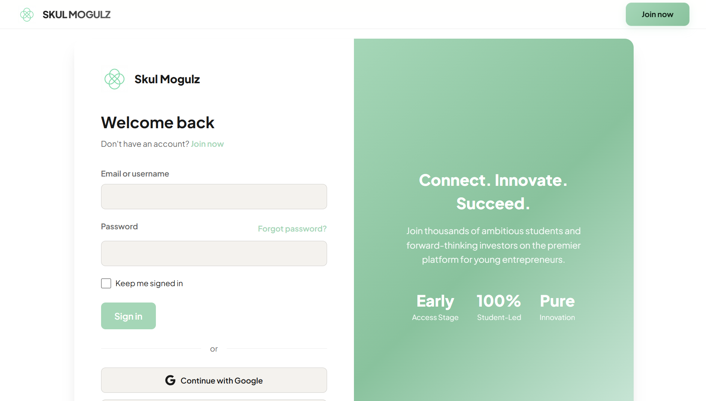
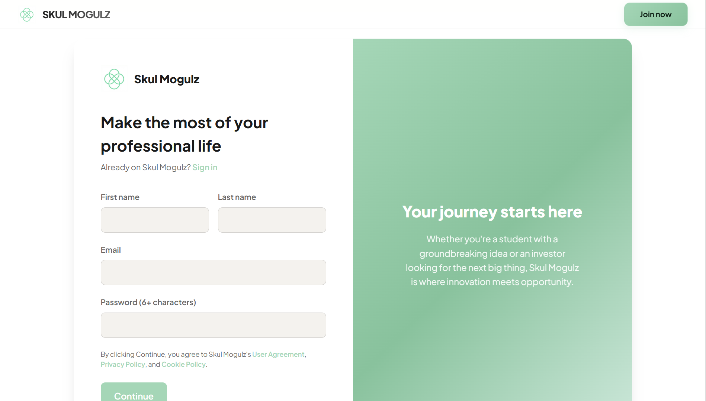
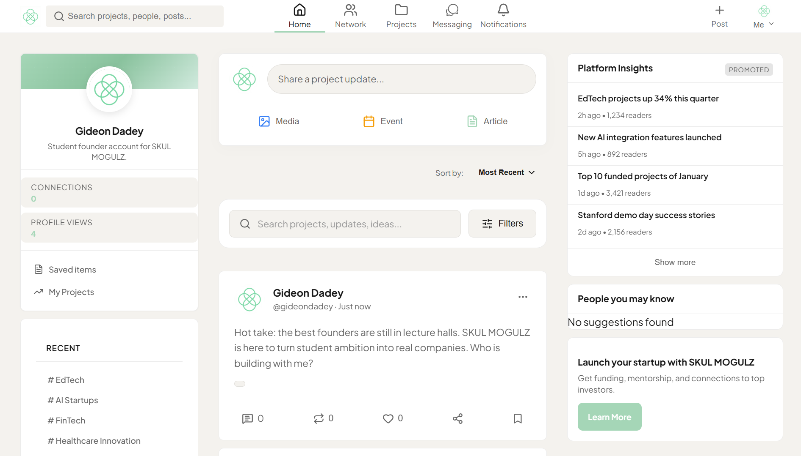
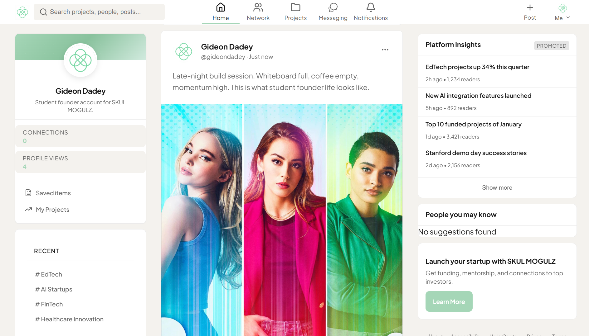
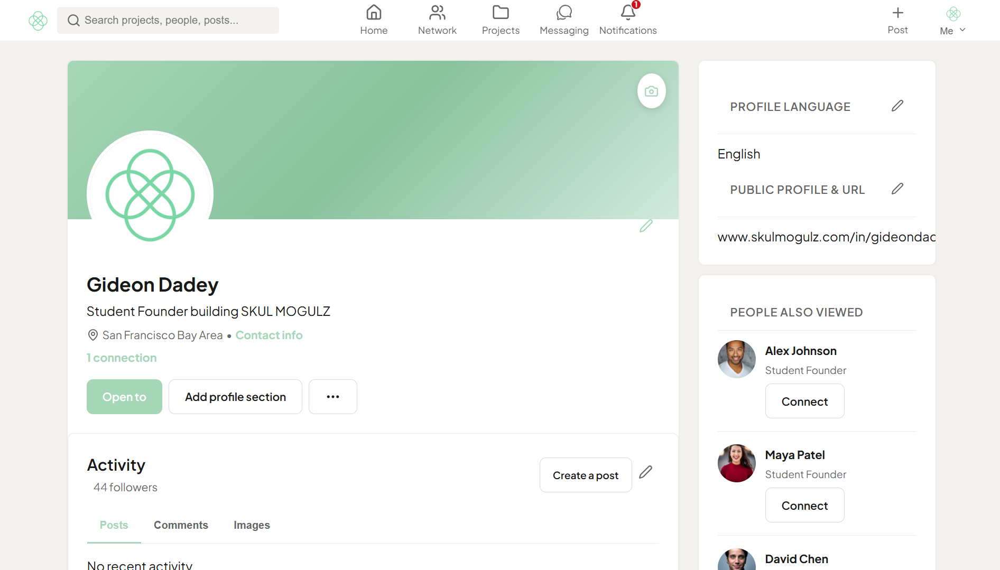
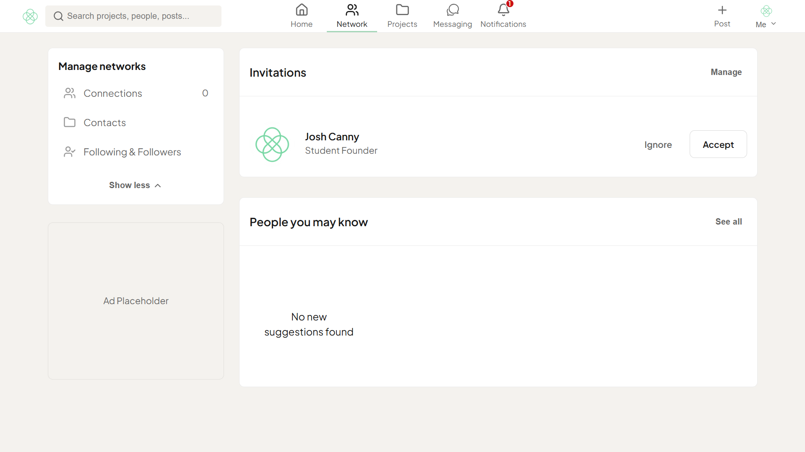

# SKUL MOGULZ

A networking platform for student founders and the people who want to back them.

Most campus builders ship in silence. Their projects live in group chats, Google Docs, and half-finished Notion pages. Investors and mentors never see the work until it's too late. SKUL MOGULZ gives those builders a place to show progress, find collaborators, and stay visible while they build.

This repo holds the web app, API, and Expo mobile client.

## Glimpse

<p>
  
  
</p>

<p>
  
  
</p>

<p>
  
  
</p>

More screenshots live in [`docs/screenshots`](./docs/screenshots).

## What works today

- Account creation and login (student or investor)
- Feed for updates, with optional images and video
- Profiles, connections, and invitations
- Project discovery and filters
- Direct messages over Socket.io
- Calls through Jitsi
- Companion Expo app for iOS and Android

## Stack

| Layer | Tools |
| --- | --- |
| Web | React, TypeScript, Vite |
| API | Node.js, Express, MongoDB, JWT |
| Realtime | Socket.io |
| Mobile | React Native, Expo Router |

## Quick start

You need Node.js 18+ and npm 9+.

```bash
git clone https://github.com/Gideon-Dadey/SKUL-MOGULZ-PERSONAL-.git
cd SKUL-MOGULZ-PERSONAL-

npm install
npm install --prefix client
npm install --prefix server
npm install --prefix mobile
```

Create `server/.env` from the example:

```bash
cp server/.env.example server/.env
```

Then fill in your MongoDB URI and JWT secret.

Run web + API together from the repo root:

```bash
npm run dev
```

- Web: http://localhost:5173
- API: http://localhost:5000

Mobile:

```bash
cd mobile
npx expo start
```

Point the mobile API base URL in `mobile/services/api.ts` at your machine's LAN IP if you're testing on a physical device.

## Repo layout

```
client/    React web app
server/    Express API and Socket.io
mobile/    Expo app
docs/      Notes, API reference, screenshots
```

## Docs

- [Architecture](./docs/ARCHITECTURE.md)
- [API](./docs/API.md)
- [Components](./docs/COMPONENTS.md)
- [Style guide](./docs/STYLE_GUIDE.md)
- [Contributing](./docs/CONTRIBUTING.md)
- [Product direction](./docs/vision/MASTER_PLAN.md)
- [Roadmap](./docs/vision/PRODUCT_ROADMAP.md)

## License

Private / proprietary for now. Reach out if you want to collaborate.
